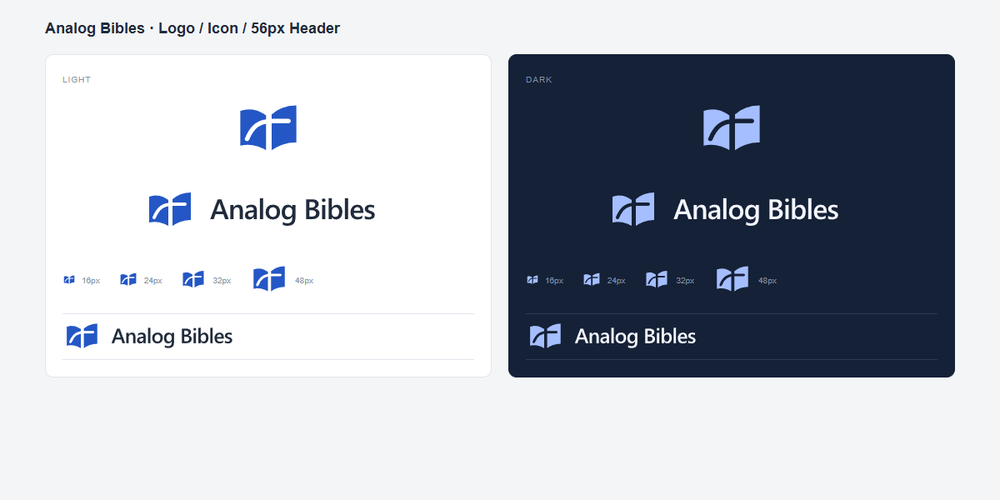

# Analog Bibles brand assets

Logo resources for [Issue #17](https://github.com/cascode-ai/analog-bibles/issues/17). The open book represents the textbook collection; the rising, settling cutout suggests an analog transient response. The selected geometry is shared by all variants.

## Files

| File | Use |
| --- | --- |
| `logo.svg` | Full logo on light backgrounds; outlined wordmark |
| `logo-dark.svg` | Full logo on dark backgrounds; outlined wordmark |
| `icon.svg`, `icon-dark.svg` | Standalone icon for light and dark backgrounds |
| `icon-black.svg`, `icon-white.svg` | Single-color variants |
| `share-card.png` | 1200 × 630 sharing image |
| `share-card.svg` | Editable sharing-image source; descriptive text uses system fonts |
| `preview.png` | Light/dark, small-size and 56px header examples |
| `../favicon.svg` | Adaptive SVG favicon using `prefers-color-scheme` |
| `../favicon-32x32.png` | 32 × 32 transparent PNG fallback |
| `../apple-touch-icon.png` | 180 × 180 PNG on white |

The logo and icon SVGs have no font or external resource dependencies. The wordmark is outlined from Segoe UI Semibold; no font files are included. The sharing PNG fixes the appearance of the system-font text in its SVG source.

## Color and sizing

- Brand blue: `#2457c5`; light-background wordmark: `#202b3c`.
- Dark-background icon: `#a4beff`; dark-background wordmark: `#f3f6ff`.
- Icon viewBox: `0 0 64 64`; full-logo viewBox: `0 0 300 64`.
- Keep the aspect ratio and built-in margins. Do not stretch the assets.
- Use the standalone icon at 16px; the curve becomes subtler at this size. Use the full logo where its wordmark remains legible, such as 220 × 47px inside a 56px header.
- For an icon beside the existing name, a 24px or 32px square is appropriate.

## Optional integration

This delivery adds files only. The main page, analytics page, privacy page, styles and metadata have not been wired to these assets.

For a logo that follows the system theme:

```html
<picture>
  <source media="(prefers-color-scheme: dark)" srcset="/brand/logo-dark.svg">
  
</picture>
```

If a page has its own theme selector, choose the asset from the active page theme instead. The default dark analytics page should use `logo-dark.svg` or `icon-dark.svg`. When an icon appears beside the visible site name, use empty alt text to avoid repeating the name.

Optional head links:

```html
<link rel="icon" href="/favicon.svg" type="image/svg+xml">
<link rel="icon" href="/favicon-32x32.png" type="image/png" sizes="32x32">
<link rel="apple-touch-icon" href="/apple-touch-icon.png" sizes="180x180">
```

For sharing metadata, use the absolute deployed URL of `/brand/share-card.png` and dimensions 1200 × 630. Platform previews, including WeChat, may cache images and require their own validation after integration.


